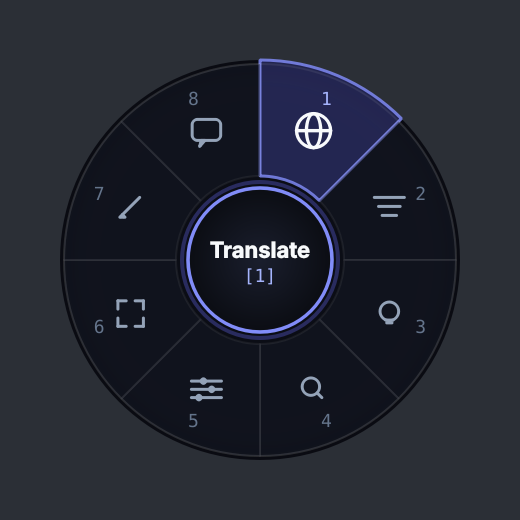
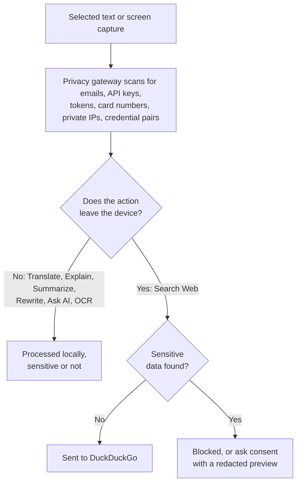
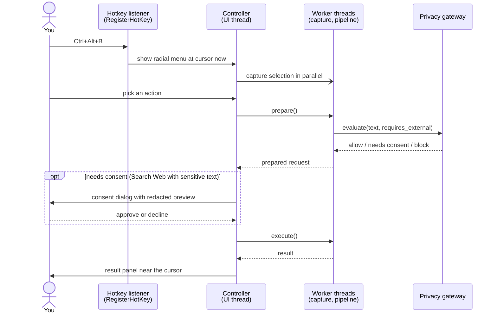

# Cursor Bite

**Intelligence at your cursor.**

<p align="center">
  <a href="https://github.com/Soham-o/cursor_bite/stargazers"></a>
  <a href="https://github.com/Soham-o/cursor_bite/issues"></a>
  <a href="https://github.com/Soham-o/cursor_bite/blob/main/LICENSE"></a>
  
  
  
</p>

A privacy-first, local-first Windows assistant that appears around your
mouse cursor when you press a hotkey — translate, explain, summarize,
rewrite, ask AI, search, or pull text off the screen, without leaving
whatever you're already looking at.

<p align="center">
  
</p>

<p align="center"><sub>The radial menu widget from <code>ui/radial_menu.py</code>, rendered
offscreen by <code>scripts/render_radial_preview.py</code>. Fonts may differ
slightly from Windows.</sub></p>

> **Demo GIF:** not yet captured. A recording of the full flow (hotkey →
> menu → result panel) needs a Windows machine. The fastest way to see it is
> to run it: [Quick Start](#quick-start) takes about two minutes on a machine
> that already has Python.

## Why

Every one of these actions already exists somewhere — a translator site, a
chat app, a search bar. What doesn't exist is one of them appearing exactly
where your mouse already is, the instant you ask for it, without a tab
switch, a paste, or an account. Select some text — a browser, a PDF, an IDE,
a chat window — press `Ctrl+Alt+B`, and a menu appears at your cursor. Pick
an action, and the answer opens right there.

## Quick Start

```powershell
python -m venv venv
venv\Scripts\activate
pip install -r requirements-core.txt
python main.py
```

Press `Ctrl+Alt+B` anywhere. That's the whole app — no account, no setup
wizard, no window to find. See [SETUP_GUIDE.md](SETUP_GUIDE.md) for a full
fresh-machine walkthrough and how to add the optional engines (translation,
AI, OCR) behind each action.

## Features

| | | |
|---|---|---|
| 🌐 **Translate** | Offline, via Argos Translate | Working |
| 💡 **Explain** | Local AI, via Ollama | Working |
| 📑 **Summarize** | Local AI, via Ollama | Working |
| ✍️ **Rewrite** | Local AI, via Ollama | Working |
| 🤖 **Ask AI** | Local AI, contextual or freeform | Working |
| 📷 **Capture Text (OCR)** | Local, via Tesseract | Working |
| 🔍 **Search Web** | DuckDuckGo — the one action that leaves your device | Working |
| 🔊 **Read Aloud** | — | Planned, not built |

Also working: a customizable global hotkey (native `RegisterHotKey` /
`WM_HOTKEY`, no keyboard hooks), a cursor-anchored radial menu with full
mouse and keyboard navigation, multi-monitor and DPI-aware positioning,
clipboard-safe selection capture, a real Settings/Privacy/Check-Components
tray UI, and graceful degradation — every optional engine above is
independently optional, and a fresh install with none of them present still
starts and runs, disabling exactly the one action each is missing.

**At startup, Cursor Bite performs zero network requests and initializes
zero optional components.** Nothing is imported, probed, or connected to
until an action needs it.

## Keyboard Reference

Once the radial menu is open:

| Key | Action |
|---|---|
| `Ctrl+Alt+B` | Open Cursor Bite |
| `1` | Translate |
| `2` | Summarize |
| `3` | Explain |
| `4` | Search Web |
| `5` | Settings |
| `6` | Capture OCR |
| `7` | Rewrite |
| `8` | Ask AI |
| Arrow keys | Move between sectors |
| `Enter` / `Space` | Activate the highlighted sector |
| `Esc` | Close / cancel |

See [HOW_TO_USE.md](HOW_TO_USE.md) for the full walkthrough.

## Privacy Model



- **Local first.** Translation, AI, and OCR all run on your machine.
  Search is the only action that sends anything off it, and the app tells
  you before it does.
- **Sensitive data never leaves the device unintentionally.** Detected
  patterns never block *local* processing — the text is already on your
  machine, and blocking it there would make the app useless for the
  documents you most want help with. They *do* block, or require explicit
  consent for, anything that would send them externally.
- **Your clipboard is yours.** Snapshotted and restored on every path,
  including the ones where capture failed or was cancelled.
- **No telemetry, no keylogging, no continuous screen or clipboard
  monitoring.** Capture only happens when you explicitly invoke it.
- **No user content in the logs** — action names, durations, and error
  *types*, never your text, prompts, translations, or search queries.

The detector is regex-based and documented as a safety net, not a
guarantee — see [SECURITY.md](SECURITY.md) for its threat model and known
limitations.

## Architecture



Ports-and-adapters layering: `ui/` and `app/` depend on `domain/`
interfaces, `infrastructure/` implements them, and `domain/` depends on
nothing else. Providers resolve lazily and fail safe, which is what makes
the startup and degradation guarantees above hold — see
`app/pipeline.py`'s `_load()` for the pattern.

The pipeline is split into `prepare()` (extract + privacy decision) and
`execute()` (do the work) specifically so a consent dialog has a seam to
sit in: it runs on the UI thread between the two phases, with the actual
work on either side running on a worker thread. Decline, and nothing had
run yet — nothing was sent.

```
cursor_bite/
├── app/              orchestration: controller, pipeline, event bus
├── domain/           interfaces + pure data, no infrastructure imports
├── infrastructure/
│   ├── ai/           Ollama
│   ├── ocr/          Tesseract
│   ├── os/           hotkey, cursor, clipboard, selection, screen capture
│   ├── privacy/      sensitive-data detector, policy engine, gateway
│   ├── search/       DuckDuckGo
│   ├── storage/      cache (in-memory); an unused-by-default SQLite option
│   └── translation/  Argos Translate
├── ui/               PyQt6: radial menu, result panel, dialogs, tray
├── config/           defaults + config.json loader
├── utils/            logging, the run_async threading helper
├── tests/            unit / integration / security
├── scripts/          dev utilities (README preview render)
└── design/           a browser-based UI/UX prototype — not the shipped app,
                       see design/web-prototype/README.md
```

## Technology

Python 3.11+ · PyQt6 · pywin32 · Argos Translate (offline) · Ollama (local)
· Tesseract (offline) · DuckDuckGo (no API key). Every dependency is free —
no paid API, no required account, no mandatory cloud service.

## Current Status

**Working today**, exercised by the test suite and by running the app:
hotkey, radial menu, tray, privacy gateway, all seven actions listed above,
Settings/Privacy/Check-Components windows, clipboard-safe capture,
graceful degradation of every optional engine.

**Experimental:** DuckDuckGo search depends on an HTML endpoint DuckDuckGo
doesn't officially support for automation; it can return a bot-check page
under load, which is reported plainly rather than silently retried forever.
Language auto-detection for translation uses a three-tier fallback (Unicode
script → statistical detection → a weak last-resort probe) that is
deliberately conservative about guessing a language with no real evidence —
see [CHANGELOG.md](CHANGELOG.md) for a bug this caught.

**Planned, not built:** Read Aloud (TTS) — the interface for it
(`TTSProvider` in `domain/interfaces.py`) exists, nothing implements it yet.
An installer/MSI beyond the current PyInstaller build. A packaged
`.exe` verified end-to-end (see [PACKAGING.md](PACKAGING.md) for exactly
what has and hasn't been runtime-checked).

## Roadmap

- Read Aloud via a local TTS engine.
- An MSI/installer instead of a copy-the-folder EXE build.
- Revisit the radial menu against a compact command-bar alternative with
  real usage data — the interaction model isn't assumed to be final.

## Limitations

- Windows only, by design.
- Selection capture uses a simulated Ctrl+C plus a clipboard snapshot —
  there is no universal cross-application "get selection" API on Windows
  without deeper accessibility integration. This works in the overwhelming
  majority of apps; a handful of unusual ones (custom-rendered canvases with
  no text layer, some elevated/protected windows) won't produce a selection
  to copy. The app tells you plainly when nothing was captured rather than
  guessing.
- Web search quality is bounded by an unofficial HTML endpoint — see
  Current Status above.
- The sensitive-data detector is pattern-based, not exhaustive — see
  [SECURITY.md](SECURITY.md).

## Development

```powershell
pip install -r requirements.txt
pip install pytest ruff
python -m pytest tests/ -q
ruff check .
```

See [CONTRIBUTING.md](CONTRIBUTING.md) for the architectural conventions
(lazy/fail-safe providers, no UI-thread blocking, no user content in logs)
this project holds itself to.

## Testing

```powershell
python -m pytest tests/ -q
```

306 tests across privacy detection and policy, every pipeline action, the
clipboard save/restore invariant, selection-capture concurrency, the
hotkey string parser, multi-monitor cursor geometry, search rate limiting
and fallback tiers, graceful degradation when packages are missing, the
two-phase consent seam, and radial-menu keyboard/mouse navigation. Runs
headless — no display, network, Ollama, Tesseract, or Argos packs required
(one test additionally exercises a real installed Argos language pack when
one happens to be present, and degrades to its "not installed" branch
otherwise).

## Packaging

```powershell
pip install pyinstaller
pyinstaller cursor_bite.spec
```

See [PACKAGING.md](PACKAGING.md) for what's bundled, what still needs to be
installed separately on the target machine, and what has and hasn't been
runtime-verified about the resulting build.

## Contributing

See [CONTRIBUTING.md](CONTRIBUTING.md). Please also read
[CODE_OF_CONDUCT.md](CODE_OF_CONDUCT.md).

## Security

See [SECURITY.md](SECURITY.md) for how to report a vulnerability. The
sensitive-data detector is regex-based and documented as a safety net, not
a guarantee — see `infrastructure/privacy/detector.py` for exactly which
patterns it covers.

## Important product principle

This project stays deliberately small. Before adding anything, ask whether
it improves *context*, *intelligence*, *speed*, *privacy*, or *reliability*.
If not, it probably doesn't belong — a focused project is worth more than a
large one.

## License

MIT — see [LICENSE](LICENSE).

---

<p align="center">
  <strong>Built by Soham Panda</strong><br>
  <sub>AI engineering • intelligent software • privacy-first systems</sub>
</p>
